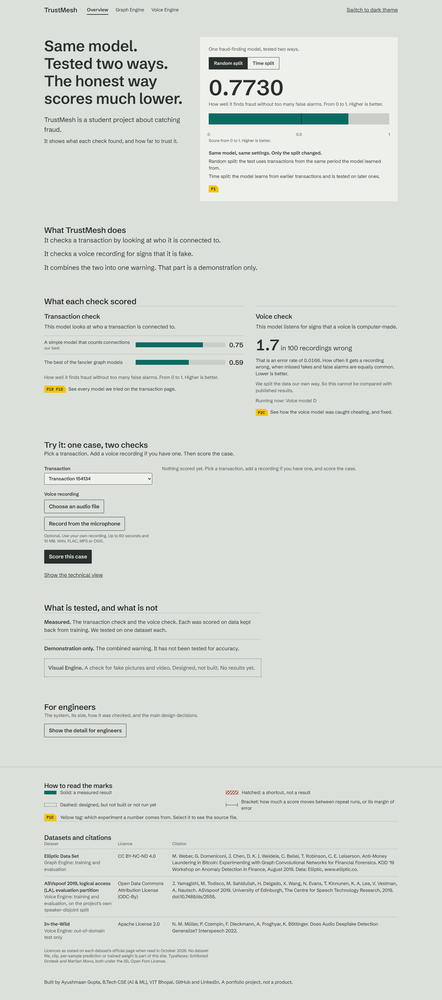
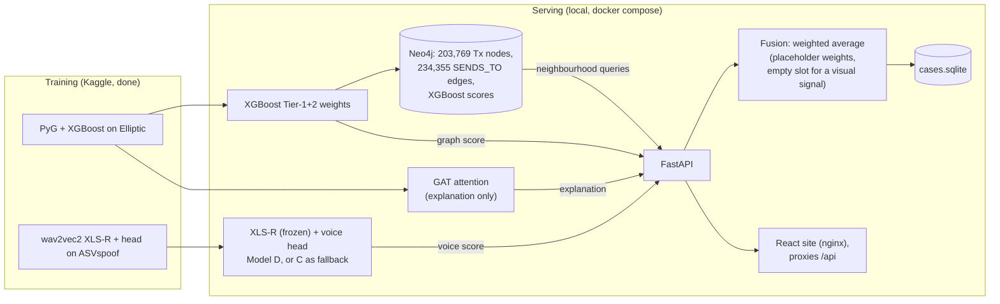

# TrustMesh

Three fraud-detection engines, each built the same way: a real dataset, an honest held-out
measurement, and a log of what broke along the way. A personal project for a portfolio and for
interviews; nothing here is a product.

| Engine | What it detects | Status | Where to read |
|---|---|---|---|
| Graph | Illicit Bitcoin transactions (Elliptic) | Done | `docs/graph_leaderboard.md` |
| Voice | Spoofed speech (ASVspoof 2019 LA) | Done | `docs/voice_leaderboard.md` |
| Visual | AI-generated images | Version 1 implemented, **not yet run** | `docs/visual_leaderboard.md` |

Every reported number comes from a real Kaggle run. Anything that has not been run says "not yet
run". Design choices and the reasons for them are in `docs/design_decisions.md`; what was built and
verified in the serving and frontend phase is in `docs/PHASE_2_STATUS_REPORT.md`.

## Results

Every number below is from a real run; the site shows the same numbers from one data file, each with its source.

| Engine | Model | Result | Notes |
|---|---|---|---|
| Graph | XGBoost on raw features plus degree, PageRank and clustering coefficient | PR-AUC 0.7482 ± 0.0030 (3 seeds) | Elliptic, time split (train on steps 1 to 30, test on 36 to 49) |
| Graph | Best graph neural network (GraphSAGE, 100-trial search) | PR-AUC 0.5913 ± 0.0085 (3 seeds) | After 175+ tuning trials across all phases |
| Graph | GraphSAGE, same settings, random split against time split | 0.7730 against 0.5115 | The random split overstates the model by 0.2616 |
| Voice | Model D: frozen XLS-R encoder, mean-only pooling, small head | EER 0.0166 ± 0.0019 (3 seeds) | The chosen model. The demo serves seed 42 of the three; that seed alone is a rough 0.0194 |
| Voice | Model C: same encoder, mean and std pooling | EER 0.0175 ± 0.0016 (3 seeds) | Statistically tied with D at twice the head parameters |
| Voice | First CNN on untrimmed audio | EER 0.0097 | **A shortcut, not a result**: it reads the silence at the start of clips. Trimmed, the same model scores 0.2380 |
| Visual | none | not yet run | Designed, not built. No results |
| Fusion | weighted average of the graph and voice scores | **no measured accuracy** | Placeholder weights; no dataset holds the same case in both signals |

Voice numbers use a 36,775-clip subset of the ASVspoof 2019 LA evaluation partition with this project's own
speaker-disjoint split. They are not comparable with published ASVspoof results. Full tables:
`docs/graph_leaderboard.md`, `docs/voice_leaderboard.md`.

## The demo: three pages, served locally

```
docker compose up --build
```

starts Neo4j, a one-shot loader that fills it, the FastAPI backend with both models loaded, and the React frontend.
Open **http://localhost:8080**. Everything runs on this machine; there is no cloud service.

| Page | What it shows |
|---|---|
| `/` Overview | The two-scores instrument (random split against time split), the status of each engine, a case desk that scores one transaction and, optionally, one voice clip, and the three main findings |
| `/graph` Graph Engine | The full leaderboard, three checks on it, and a live desk: score a transaction and see its neighbourhood from Neo4j |
| `/voice` Voice Engine | The silence shortcut, the model progression, the generalisation tests, and a live desk: score your own recording |

Each page reads in plain language by default; "Show the detail for engineers" opens the exact terms, protocol and
system detail. Light and dark themes (the first visit follows the operating system). To try everything yourself,
step by step: `docs/HOW_TO_TEST_MYSELF.md`. On Windows, `start.bat` starts the whole stack and `stop.bat` stops it. Screenshots of the pages' empty states:
`docs/frontend_screenshots/` (three widths, both themes). They contain aggregate results only.





| Endpoint | What it does |
|---|---|
| `GET /graph/score/{node_id}` | Real XGBoost Tier-1+2 risk score and verdict for an Elliptic transaction |
| `GET /graph/explain/{node_id}` | GAT attention over the node's in-neighbours, labelled as a secondary model, not the score |
| `GET /graph/query/neighbors/{id}?hops=2`, `/illicit/{id}`, `/path?source=&target=`, `/flagged-neighbors/{id}` | Cypher queries against Neo4j |
| `POST /voice/score` | Spoof probability for an uploaded clip (`?model=C` picks the fallback model) |
| `POST /case/score` | Both scores plus the fused result; both components are always returned beside it, and `visual` is `null` |
| `GET /cases/flagged`, `/cases`, `/health` | Flagged-case view, all cases, and what is loaded |

### Honest limits

- The graph score is real and checked: on startup the server confirms that the loaded XGBoost weights reproduce the
  Phase 1D seed-42 test PR-AUC (0.7474; 0.7482 +/- 0.0030 over three seeds).
- The voice score comes from the real Phase 2C Model D head (mean-only pooling) on a frozen XLS-R encoder, and Model D
  is what is served (`/health` shows `phase2c_D_ssl_mean_only_P1_s42.pt`, fallback off). That file is **seed 42 of
  the three Model D seeds**. The headline Model D result stays the 3-seed mean, EER 0.0166 +/- 0.0019; seed 42's own
  EER computed from its saved test scores is 0.0194, a rough single-seed figure and not a new headline. Model C
  stays loadable with `?model=C`, and is the automatic fallback if D's weights are ever missing (the response then
  says `fallback_used`, and the site shows it).
- **Voice verdict thresholds are calibrated on the same test scores they were taken from**, so they are not an
  out-of-sample false-flag rate. Model D: high at spoof probability 0.6578, medium at 0.0239 (the values that flag 1%
  and 10% of the 2,165 bonafide test clips in `phase2c_test_scores.npz`). The graph thresholds are different: they come
  from validation-period nodes the model never trained on.
- **The combined score has no validated accuracy, and it cannot have one with this data.** Elliptic (transactions)
  and ASVspoof / In-the-Wild (voice) are unrelated datasets: no transaction is linked to any voice clip, so there
  is no joint ground truth. The fusion weights (0.5 / 0.5) and bands (medium from 0.30, high from 0.60) are
  placeholders that are **not calibrated against labeled joint data**, and the two scores are not calibrated
  against each other either. A demo case pairs a real transaction with a clip that were never part of one fraud case.
  A real calibration needs cases with both a known transaction-fraud outcome and a known voice-spoof outcome.
- The Visual Engine is designed and coded but has never been run. The fusion layer has an empty slot for it and
  nothing else.
- Eight local test clips were scored correctly during verification. That is a plumbing check, not an accuracy result.
- One dataset per engine. Nothing here says the findings transfer to other transaction graphs or other speech corpora
  beyond the small In-the-Wild check.

### Run it

```
docker compose up --build        # Neo4j + loader + API + frontend
```

First-time inputs that are not in the repository (all under `data/` or `artifacts/`, which are git-ignored):

1. Elliptic downloads itself through PyG on first start (about 700 MB).
2. The XLS-R encoder: `data/models/wav2vec2-xls-r-300m/` (`config.json` + `pytorch_model.bin` from
   `facebook/wav2vec2-xls-r-300m`, 1.27 GB). Without a local copy it is fetched from the Hub on first start.
3. Model weights in `artifacts/graph/` and `artifacts/voice/` (from the Kaggle runs; see `docs/kaggle_setup.md`).

Then: http://localhost:8080 (site), http://localhost:8000/docs (API), http://localhost:7474 (Neo4j browser, user
`neo4j`, password from `NEO4J_PASSWORD`, default `trustmesh-demo` for the local stack only). Settings are in
`.env.example`. The stack needs about 4 GB of memory (the API holds about 2.1 GB, Neo4j up to about 1.4 GB).

Without Docker for the app: `docker compose up -d neo4j`, `python -m serving.load_neo4j`,
`uvicorn serving.api:app`, and in `frontend/`: `npm install`, `npm run dev` (http://localhost:5173).

`scripts/verify_serving.py` checks every endpoint against the live stack; `scripts/check_frontend_numbers.py` re-checks
every number on the site against its source file; `scripts/seed_cases.py` fills the cases table.

For a temporary public deployment, the demo script and the teardown checklist, read `docs/demo_runsheet.md` first.
In short: `docker-compose.deploy.yml` closes Neo4j's and the API's ports and requires a new Neo4j password.

## Layout

- `frontend/` -- the React site (Vite, TypeScript, Tailwind). `src/data/evidence.json` is the one place numbers live.
- `serving/`, `docker-compose.yml`, `docker-compose.deploy.yml`, `Dockerfile`, `.env.example` -- the API, Neo4j loader,
  fusion, cases table and their settings. `scripts/verify_serving.py`, `seed_cases.py`, `check_frontend_numbers.py`,
  `check_contrast.py`, `capture_screenshots.py`, `calibrate_voice_thresholds.py` support them.
- `engines/graph/`, `engines/voice/`, `engines/visual/` -- the code, unit-tested.
- `notebooks/src/*.py` -- notebook sources. `scripts/build_notebooks.py` inlines the engine modules
  into `notebooks/*.ipynb`, so one uploaded file runs on Kaggle. Edit the sources, never the `.ipynb`.
- `tests/` -- unit tests and an end-to-end smoke run of each notebook on synthetic data.
- `artifacts/` -- aggregate results of real runs (JSON, plots).

## Running the local checks

No training happens on a local machine; these are CPU checks on synthetic data.

```
py -3.11 -m venv .venv
.venv\Scripts\python.exe -m pip install -r requirements-dev.txt
.venv\Scripts\python.exe -m pytest tests
.venv\Scripts\python.exe tests/smoke_notebook_05.py
.venv\Scripts\python.exe scripts/build_notebooks.py --check
.venv\Scripts\python.exe -m pyflakes engines scripts tests serving
.venv\Scripts\python.exe scripts/check_frontend_numbers.py
.venv\Scripts\python.exe scripts/check_contrast.py
cd frontend; npm install; npm run build      # type check, tests, then the production build
```

Real runs happen on Kaggle; `docs/kaggle_setup.md` has the steps for each notebook.

## Datasets and citations

The datasets below are used under their own terms, which are non-commercial and do not allow
redistribution. **This repository therefore contains no dataset image, video, frame, embedding,
per-image metadata table or per-image prediction**, and no model weights trained on these datasets
until their licenses have been checked. Only code, specifications, aggregate metrics and aggregate
plots are committed. `.gitignore` lists the excluded folders and
`scripts/check_no_dataset_outputs.py` fails if one of them is staged.

Licenses are given as found on each source's own page, with the date they were read. Where two
sources disagree, both are listed. A citation that has not been looked up says so.

| Dataset | Used for | Source | License as found | Citation |
|---|---|---|---|---|
| Elliptic | Graph Engine | Kaggle `ellipticco/elliptic-data-set` (loaded through PyTorch Geometric `EllipticBitcoinDataset`) | CC BY-NC-ND 4.0 (Kaggle's record for the dataset, read 2026-10-08) | M. Weber, G. Domeniconi, J. Chen, D. K. I. Weidele, C. Bellei, T. Robinson, C. E. Leiserson, "Anti-Money Laundering in Bitcoin: Experimenting with Graph Convolutional Networks for Financial Forensics", KDD '19 Workshop on Anomaly Detection in Finance, 2019; data by Elliptic, www.elliptic.co |
| ASVspoof 2019 LA | Voice Engine | Hugging Face `SpeechAntiSpoofingBenchmarks/ASVspoof2019_LA` (evaluation partition only); original at Edinburgh DataShare, handle 10283/3336 | Open Data Commons Attribution License, ODC-By (DataShare `LICENSE_text.txt` and the Hugging Face card, read 2026-10-08). It covers the database, not the audio contents; the terms of the underlying VCTK speech were not read | J. Yamagishi, M. Todisco, M. Sahidullah, H. Delgado, X. Wang, N. Evans, T. Kinnunen, K. A. Lee, V. Vestman, A. Nautsch, "ASVspoof 2019", University of Edinburgh, 2019, doi:10.7488/ds/2555 |
| In-the-Wild | Voice Engine, out-of-domain check | Hugging Face copy of `release_in_the_wild.zip`; official page deepfake-total.com/in_the_wild | Apache License 2.0 (official page, read 2026-10-08) | N. M. Müller, P. Czempin, F. Dieckmann, A. Froghyar, K. Böttinger, "Does Audio Deepfake Detection Generalize?", Interspeech 2022 |
| OpenFake | Visual Engine V1, training and tests | Hugging Face `ComplexDataLab/OpenFake` (v2) | Dataset card: CC BY-NC 4.0 (read 2026-10-07). The research handbook reports CC BY-NC-SA 4.0 for the paper (not re-verified). The two differ. | Livernoche et al., "OpenFake: An Open Dataset and Platform Toward Real-World Deepfake Detection", arXiv:2509.09495, 2025 (from the dataset card) |
| ArtiFact | Visual Engine V1, training and tests | Kaggle `awsaf49/artifact-dataset` | not yet looked up (Task 0 of the Visual Engine records the license of the Kaggle copy) | not yet looked up |
| FFHQ (128x128 thumbnails) | Visual Engine V1, real faces | Kaggle re-upload "Flickr Faces 70k Thumbnails 128x128" | The Kaggle page says "Unknown"; the original `NVlabs/ffhq-dataset` lists CC BY-NC-SA 4.0. The two differ. | not yet looked up |
| Synthbuster | Visual Engine V1, test only (not yet used) | Zenodo record 10066460 | CC BY-NC-SA 4.0 (as seen by the project owner, 2026-10-06) | not yet looked up |
| Deepfake-Eval-2024 | Visual Engine, real-world test only (not yet used; access requested) | Hugging Face, gated | Evaluation only; training is not permitted | not yet looked up |
| Celeb-DF | Visual Engine Versions 2-3 only (not used in V1) | Request form | Non-commercial research only; no reproduction of the videos or of derived data | Required: the Celeb-DF paper, CVPR 2020 (full reference not yet looked up) |
| FaceForensics++ | Visual Engine Versions 2-3 only (not requested yet) | Request form (TUM) | Non-commercial research and education only | Required: FaceForensics (arXiv 2018) and FaceForensics++ (ICCV 2019), plus the Google/Jigsaw DeepFakes Detection Dataset if used (full references not yet looked up) |

Elliptic's licence (CC BY-NC-ND 4.0) allows non-commercial sharing with attribution but not sharing of adapted
material. Whether per-transaction model scores or trained weights are adapted material is an open owner decision
(`docs/design_decisions.md`, "Terms findings"; not legal advice), so neither is in this repository. The site's
typefaces, Schibsted Grotesk and Martian Mono, are under the SIL Open Font License 1.1.

Open point: whether trained weights count as "derived data" under Celeb-DF's wording is unresolved.
Until it is, weights stay out of this repository; their SHA-256 hashes are recorded with the results.
